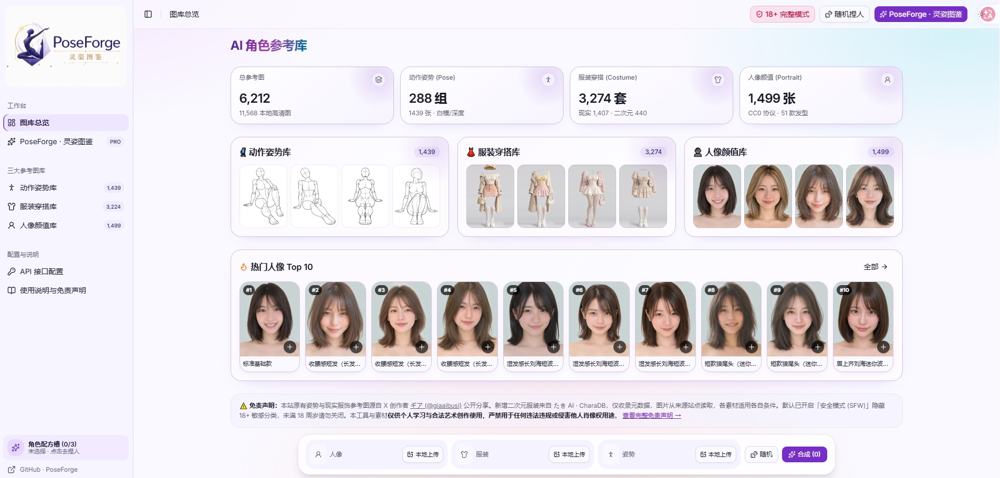

# PoseForge · 灵姿图鉴

基于 [anhao/ai-pose-gallery-zh](https://github.com/anhao/ai-pose-gallery-zh) 的中文 AI 角色参考与合成工作台。包含姿势、服装、人像图库、AI 合成台与 ComfyUI 自定义节点插件。

**本站：** <https://ai-pose-gallery-zh.sincalwow-361.workers.dev/> · **本仓库：** [sincalaway/PoseForge](https://github.com/sincalaway/PoseForge) · **上游演示：** <https://ai-pose-gallery.anhao.app/>

## 与上游原仓库的完整差异

以已同步的上游提交 [`4889391`](https://github.com/anhao/ai-pose-gallery-zh/commit/488939139c69acfe078372b39d4bd0c457dc060e) 为基线，本仓库额外保留以下改动。完整行为、限制及文件索引见 [PoseForge 差异说明](docs/poseforge-differences.md)。

- **Qwen Image 2.1 多参考工作流：** 新增 `qwen21_multiref` ComfyUI API 预设，绑定人像、服装、姿势三个参考图槽位与提示词节点，并支持 Qwen 2.1 的 `<imageN>` 引用格式。这是本地 ComfyUI 工作流，须另行安装对应模型和节点，不等同于云端 Qwen 接口。
- **Pollinations 与 ModelScope：** 在原有 Gemini、OpenAI GPT Image、百炼 Qwen、火山 Doubao、本地 ComfyUI 之外，新增两家 provider 的配置、模型选项、旧配置补全与请求实现。ModelScope 使用异步任务及状态轮询；两家新增服务的参考图均须为服务端可访问的 URL，暂不接受本地上传/Base64 或三合一拼图。
- **可扩展的 provider 适配层：** 把统一生成入口与厂商协议拆分为 facade、adapter 注册表、请求上下文和公共 HTTP 工具；原有四家云端协议通过兼容 adapter 保留，方便后续接入服务。
- **ComfyUI 界面重构：** 从合成台提取独立的 `ComfyWorkflowBindings` 组件，集中维护人像/服装/姿势图片节点、提示词节点和工作流校验反馈；这是维护性重构，不另算新增生图能力。
- **PoseForge 品牌与虹彩玻璃主题：** 更新侧栏品牌和仓库链接，调整浅色/深色配色、渐变背景、玻璃顶栏、统计卡、图库入口及人像卡片；补充键盘焦点和减少动态效果支持。
- **生产静态资源补全：** `pnpm build` 在 Vite 构建后自动复制图库数据、原图、缩略图和站点元文件至 `dist/`，并校验必需文件与 Cloudflare 的 25 MiB 单文件限制，避免只有前端页面、没有图库素材的发布结果。
- **生产与开发代理扩展：** 加入 Pollinations、ModelScope 的精确 HTTPS 默认白名单，支持 GET 状态查询和 POST 提交，转发所需 ModelScope 请求头；保留请求体大小限制和可配置目标规则。
- **受控的每日上游同步：** GitHub Actions 每天同步上游新增和修改；删除只登记，须先审阅并在下一轮手动确认。保存同步基线、待确认清单与运行摘要，不重写现有 Git 历史。本仓库的 README、差异/适配器文档与同步配置受保护，避免被上游覆盖。
- **项目文档与部署口径：** 补充适配器开发指南、上游同步规则、ComfyUI Desktop CORS 说明；区分代码许可和素材授权，明确本站使用独立 Worker，不替换旧站。

### 已同步的上游更新，不是 PoseForge 独有差异

此前摘要中的 PR #32–#41 相关改进已属于上述上游基线：通知队列与显示时长、ComfyUI WebSocket/HTTP 任务跟踪与刷新恢复、参考图缩放和平移、单槽位重抽样、生成时参考图快照、过期异步读取隔离，以及新增动漫和中国历代服饰数据。这些能力继续保留，但不应与本仓库独有改动混为一谈。

**当前规模：6,212 条参考数据、12,168 张本地图片（原图与缩略图合计），另有 1,760 张远程来源参考图。** 其中新增 50 套 PoseForge 用户授权服饰及 73 张原图/73 张缩略图；其余上游图库数据与已同步基线一致。深度图与素体姿势共享 ID，不重复计算参考条目。




<details>
<summary>手机端预览</summary>


</details>

**图库原站：** [姿势库（素体白模）](https://ai-pose-gallery.pages.dev/) · [姿势深度图库（Depth）](https://ai-pose-depth-gallery.pages.dev/) · [服装库](https://ai-costume-gallery.pages.dev/) · [人像库](https://ai-portrait-gallery.pages.dev/)

**原有图库作者：** ギア（@giaaibusi）　**中文版维护：** Anhao · [X @anhao_ai](https://x.com/anhao_ai)。动漫服装、历代服饰的来源快照与授权信息见 `data/charadb/source.json`、`data/gia-anime/source.json` 和 `data/shisei/`；本仓库新增的 50 套服饰由 `sincalaway` 提供，授权记录见 `data/poseforge/source.json`。

> **使用提示：** 图库含有部分 18+ 成人向素体姿势与性感穿搭参考。应用默认开启安全模式以隐藏相关分类；未成年人不得关闭安全模式或访问成人内容。请遵守当地法律、尊重肖像权与隐私权，并确认你有权使用上传的图片。
>
> **来源与授权：** 图片和原始数据来自各来源公开图库，具体授权以其声明为准。本仓库的代码许可不自动扩展到图片、缩略图和原始数据；请勿擅自再分发或用于未经授权的商业用途。新增的 PoseForge 服饰仅获准在本仓库公开展示与分发，不构成通用开放许可；原图来源 URL 未提供。

## 项目包含什么

- **姿势库：** 中文检索与分类、按组或单张浏览、多角度切换、高清预览和下载；可在素体白模与深度图之间切换。
- **服装库：** 现实服装、CharaDB 动漫服装、GIA 动漫服装及中国历代服饰；按来源、分类和标签筛选，查看中文描述与提示词。
- **人像库：** 按分区、发长、发型、精选题集和热门榜单筛选。
- **AI 合成台：** 将人像、服装、姿势和自定义附加参考图组合成配方；支持参考拼图、结构化提示词、图片生成记录及本地历史，姿势槽位支持素体白模/深度图切换。
- **图像生成接口：** Gemini、OpenAI GPT Image、百炼 Qwen、火山 Doubao、Pollinations、ModelScope，以及本地 ComfyUI。服务可用性、模型权限和额度以各提供方为准；代码内提供选项不代表已对外部服务逐一实测。
- **扩展接口：** 新增 provider 的类型、配置、适配器和代理注册步骤见 [图片生成 provider 适配器开发指南](docs/image-provider-adapters.md)。
- **ComfyUI 插件：** 在画布中通过姿势、服装、人像和三合一配方节点浏览图库、输出参考图与提示词；姿势和配方节点支持深度图，可用于 ControlNet Depth 工作流。

## 数据规模

| 图库 | 参考条目 | 本地图片（原图 + 缩略图） | 远程参考图 |
| --- | ---: | ---: | ---: |
| 姿势（素体白模） | 1,439 | 2,878 | — |
| 姿势深度图（与姿势共享 ID，不重复计条） | — | 2,878 | — |
| 现实服装（含新增 PoseForge 50 套） | 1,457 | 2,960 | — |
| CharaDB 动漫服装 | 440 | — | 440 |
| GIA 动漫服装 | 1,320 | — | 1,320 |
| 中国历代服饰（57 套、227 个视角） | 57 | 454 | — |
| 人像 | 1,499 | 2,998 | — |
| **合计** | **6,212** | **12,168** | **1,760** |

本地 `img/` 与 `thumbs/` 各有 6,084 张文件。新增的 PoseForge 集包含 73 张 900×1200 WebP 原图和对应缩略图；其中 PF-C-0007 正面图同时作为主图与视角图引用，只按一张图片计数。远程参考图依赖来源站点可用性，不属于本地镜像文件。

## ComfyUI 使用方式

### 在 ComfyUI 画布中使用图库节点

将整个仓库克隆到 ComfyUI 的 `custom_nodes` 目录。插件会从仓库根目录读取图片和数据，因此不要只复制 `comfyui_plugin/` 子目录。

```bash
cd /path/to/ComfyUI/custom_nodes
git clone --depth 1 https://github.com/sincalaway/PoseForge.git PoseForge
```

重启 ComfyUI 后，在画布空白处右键打开 **「AI角色三合一参考图集」** 节点分类。插件提供姿势、服装、人像和三合一配方节点；姿势与配方节点可切换素体白模或深度图，配方节点可组合参考图并输出图片张量与提示词。

### 从网页合成台调用本机 ComfyUI

- **本地开发与预览：** Vite 已配置 `/comfy` 同源代理，默认转发到 ComfyUI Desktop 的 `http://127.0.0.1:8000`。服务地址不同时，可设置 `COMFYUI_URL`：

  ```bash
  COMFYUI_URL=http://127.0.0.1:8188 pnpm dev
  ```

- **线上网页：** 浏览器会直接访问配置的 ComfyUI 地址。请按 ComfyUI 的部署方式开放服务，并仅将实际网页来源加入 CORS 允许列表；不要为了方便使用通配来源公开服务。

#### ComfyUI Desktop 启动参数

从本站调用 ComfyUI Desktop 时，配置以下启动参数：

```bash
--enable-manager --enable-cors-header https://ai-pose-gallery-zh.sincalwow-361.workers.dev
```

`--enable-manager` 用于开启 Manager（推荐）；`--enable-cors-header` 用于允许当前前端来源跨域访问（线上直连所需）。在 Desktop 的 **实例管理 → 当前实例 → 启动参数** 中填写，随后点击 **Restart to apply changes** 重启实例。

如果使用其他前端域名，必须替换为其准确来源；本示例不再指向旧站 `ai-pose-361.workers.dev`。

在应用「接口配置」中选择 **本地 ComfyUI**，即可检测连接、导入 API 工作流 JSON、绑定图片/提示词节点并设置参数。Qwen Image 2.1 多参考预设仍依赖本机对应模型和节点。详见 [ComfyUI 本地指南](docs/comfyui-local.md) 与 [工作流参数指南](docs/comfyui-workflow-parameters.md)。

## 本地开发

需要 **Node.js `^20.19.0` 或 `>=22.12.0`**（Vite 8 要求）和 pnpm。仓库包含大量图片素材，克隆和构建会占用较多磁盘空间。

```bash
pnpm install --frozen-lockfile
pnpm dev                 # 本地开发服务器：http://localhost:5173
pnpm build               # TypeScript 检查、生产构建并复制完整静态素材
pnpm lint                # Oxlint 代码检查
pnpm preview             # 本地预览已构建的网站
```

本地数据维护脚本使用 Python 3：

```bash
python3 scripts/download.py
DATASET=depth python3 scripts/download.py
python3 scripts/apply_translation.py
python3 scripts/verify.py
```

## 部署

### 当前独立 Cloudflare Worker

本站的 Worker 名称为 **`ai-pose-gallery-zh`**，发布地址为 <https://ai-pose-gallery-zh.sincalwow-361.workers.dev/>。`worker.ts` 提供 API/静态资源入口，`wrangler.jsonc` 指向 `dist/`。这是独立部署目标，不替换旧站 `https://ai-pose-361.workers.dev/`。

```bash
pnpm install --frozen-lockfile
pnpm build
npx wrangler deploy
```

### GitHub 更新后自动部署

在上述 **现有 Worker** 的 **Settings → Builds → Git repository → Connect** 中，授权并选择 `sincalaway/PoseForge`，使用以下设置：

| 设置 | 值 |
| --- | --- |
| 生产分支 | `main` |
| 根目录 | 仓库根目录 `/` |
| 构建命令 | `pnpm build` |
| 部署命令 | `npx wrangler deploy` |
| 构建开关 | 启用生产构建 |

Cloudflare 安装依赖后，构建命令会带上图库素材。**只有完成仓库授权和 Worker 的 Git 连接后，`main` 的提交才会触发自动部署；仅推送源码并不等于页面已更新。** 如仓库未出现在选择列表，需先在 GitHub 的 Cloudflare 应用授权中加入该仓库。部署状态以 Cloudflare 的构建与部署结果为准，不在仓库中保存登录凭据或 API Key。

### 其他部署方式

`bash scripts/build.sh` 同样可准备完整 `dist/`。若另建 Cloudflare Pages 项目，将其构建命令设为 `bash scripts/build.sh`、输出目录设为 `dist`；`functions/api/proxy.ts` 提供 Pages Functions 的 `/api/proxy` 代理入口。不要为了接入 Git 而误建替代当前 Worker 的同名站点。

## 上游同步

仓库每天 02:17 UTC 自动同步上游新增和修改；上游删除会保留并等待人工确认。同步采用按文件更新，不是语义合并；上游修改同一源文件时可能覆盖本仓库的自定义实现，请审阅同步提交。README、PoseForge 差异/适配器文档与同步逻辑由本仓库维护。具体规则及确认步骤见 [上游同步说明](docs/upstream-sync.md)。

## 主要目录

```text
.
├── comfyui_plugin/       # ComfyUI 节点、路由和画布端扩展
├── data/                 # 图库原始/中文数据及来源记录
├── docs/                 # 差异说明、ComfyUI 与 provider 指南、预览图
├── functions/api/        # Cloudflare Pages Functions API 代理
├── img/                  # 原图（含 depth/ 与历代服饰视角）
├── thumbs/               # 对应缩略图
├── scripts/              # 数据、图片、构建与受控同步脚本
├── skills/               # 面向 Agent 的图库检索技能
├── src/                  # 前端、provider 适配层与工作流预设
├── worker.ts             # Cloudflare Workers 入口
├── wrangler.jsonc        # 独立 Worker 配置
└── README.md
```

**主要技术栈：** React 19、TypeScript 7、Vite 8、TanStack Router/Query、Tailwind CSS 4、Radix UI。ComfyUI 插件使用 Python 与 ComfyUI 自带运行环境。

## Agent 技能

`skills/` 包含姿势、服装和人像图库检索技能，图片索引使用相对路径引用仓库素材；安装时请保留仓库目录结构。具体说明见各自的 `SKILL.md`。

## 许可与责任

代码许可见 [LICENSE](LICENSE)。图库图片、缩略图及数据的权利和授权条件以各原站点声明为准，不因代码许可而改变。使用者需自行确认素材、生成结果及相关操作符合适用法律，并对上传内容和生成内容负责。
